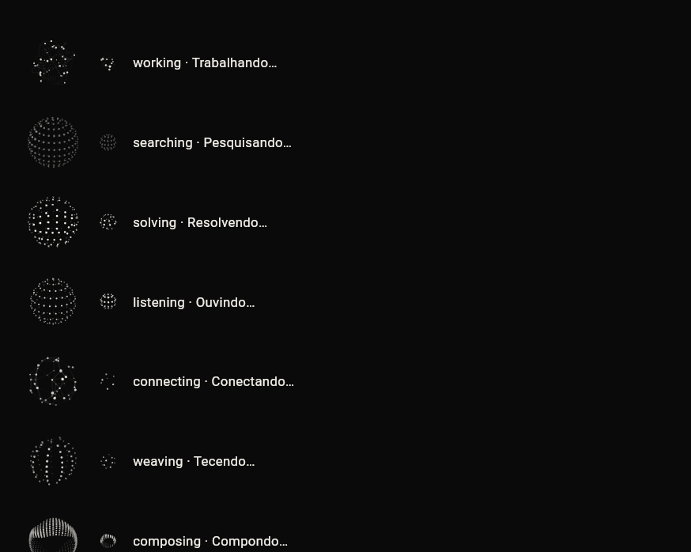

# thinking_orbs_dart

Port Dart/Flutter das orbes de pontos animadas **[thinking-orbs](https://github.com/Jakubantalik/thinking-orbs)**, de Jakub Antalik (MIT). A geometria, os presets e a ideia são dele; este repo só traduz o motor para Dart e adiciona um widget Flutter.

- 9 estados × 2 tamanhos (64 px e 20 px): `working`, `searching`, `solving`, `listening`, `connecting`, `weaving`, `composing`, `breathing`, `shaping`.
- **Verificado contra o original:** os 72 casos de `spec/orbs-golden.json` (9 estados × 2 tamanhos × 4 instantes) batem ponto a ponto, tolerância 1e-4. Os testes estão em `test/thinking_orb_test.dart`, com o arquivo em `test/fixtures/orbs-golden.json`.

## Demo



App de exemplo em `example/`: `cd example && flutter run -d chrome`.

## Arquivos

| Arquivo | O que é |
|---|---|
| `lib/src/orb_engine.dart` | Geometria dos 9 modos. Matemática pura, sem Flutter. |
| `lib/src/orb_presets.dart` | **Gerado** a partir da seção `resolved` do golden. Não edite à mão. |
| `lib/src/thinking_orb.dart` | Widget `ThinkingOrb` (`CustomPainter` + `Ticker`, relógio compartilhado). |

## Uso

```dart
ThinkingOrb(state: OrbState.composing, size: OrbSize.large)
```

Parâmetros: `state`, `size` (`large` 64 px, `small` 20 px), `speed`, `paused`, `color` (padrão off-white `#F2EFE8`), `semanticLabel`.
Com movimento reduzido do sistema (`MediaQuery.disableAnimations`) o widget mostra um quadro estático (t = 0,6).

## Rótulos em pt-BR

Os rótulos de acessibilidade (`OrbState.label`) estão em **português do Brasil**, diferente do original em inglês. Passe `semanticLabel` para trocar.

## Testes

```bash
flutter test
```

## Licença

MIT. Copyright do original © 2026 Jakub Antalik, mantido em [LICENSE](LICENSE); o port tem copyright próprio na mesma licença.
